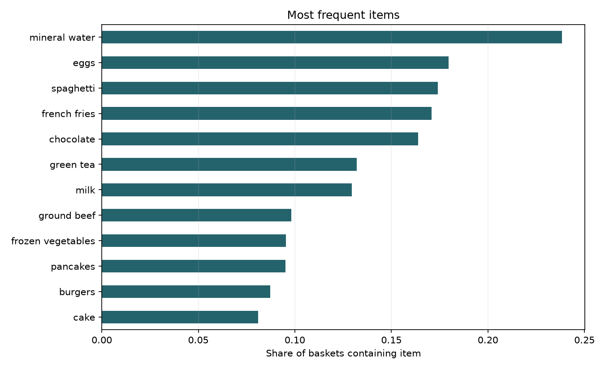
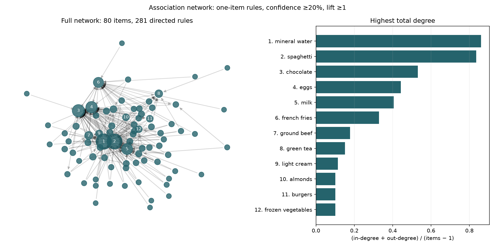

# Market Basket and Association Network Analysis

A reproducible study of item co-occurrence in retail transaction baskets using
Apriori and a directed association network. The goal is to explain what support,
confidence and lift reveal—and what they cannot establish about buying behavior.

## Method

- Read a headerless, variable-width basket CSV and encode item presence.
- Mine itemsets at support .003; inspect positive rules and extend to .001 for
  negative associations.
- Verify rule support, confidence and lift independently against basket counts.
- Build a NetworkX graph from one-item rules with confidence ≥20% and lift ≥1.

Python, pandas, NumPy, mlxtend, NetworkX and Matplotlib provide the implementation.
The notebook is a small entry point into reusable code, not a second implementation.

## Run

Validated with Python 3.12; use an isolated environment. Core dependencies are
pinned to the versions recorded in the checked-in result receipt:

```sh
python -m venv .venv
# Activate .venv using your operating system's command.
python -m pip install -r requirements.txt
python -m unittest discover -s tests -v
python -m src.pipeline --data data/local/Market_Basket_Optimisation.csv
```

Run from the repository root. Acquire the **original study dataset** using
[data/README.md](data/README.md); raw transactions are intentionally omitted.
For Jupyter, also install `requirements-notebook.txt` and open
`notebooks/market_basket_analysis.ipynb`.

## Results and evidence

`results/summary.json` is the compact execution receipt: file identity, item/rule
counts, network dimensions, dependency versions and count-based metric checks.
Figures display aggregates only; no raw transaction records are published.
Historical classroom counts and corrections are explained in
[the methodology](docs/METHODOLOGY.md). Current results are generated separately.

The corrected run reproduced these aggregate counts on the acquired 7,501-basket
file:

| Quantity | Recomputed result |
|---|---:|
| Distinct items | 119 |
| Itemsets at support .003 | 1,443 |
| Rules with lift ≥1 at support .003 | 4,880 |
| Rules at support .001, all confidence values | 41,996 |
| Negative rules with lift <1 | 1,406 |
| Network nodes / directed edges | 80 / 281 |
| Maximum metric difference from direct-count checks | 0.0 |

Five focused unit tests passed. Every initial and extended rule was checked against
an independent transaction-count implementation. For example, the recomputed
`olive oil → cookies` rule has confidence about 2.43% and lift .302: it is a negative
association, not evidence that buying olive oil causes cookie avoidance.





## Interpretation and limits

Lift below 1 is a negative association relative to independence, even when a rule's
confidence looks substantial. High lift on sparse baskets can be unstable. The
network is descriptive; centrality does not establish purchase causality, optimal
store placement or improved sales. No customer-level recommendation test or
business intervention was performed. Held-out rule stability would be a useful
next step before proposing operational changes.

## Credits

Prepared from Ginno D. Arostique Jr.'s CCS 230 coursework. Modularization, tests and
publication documentation were prepared with Codex assistance. See
[ATTRIBUTION.md](ATTRIBUTION.md) for source lineage and dataset restrictions.
